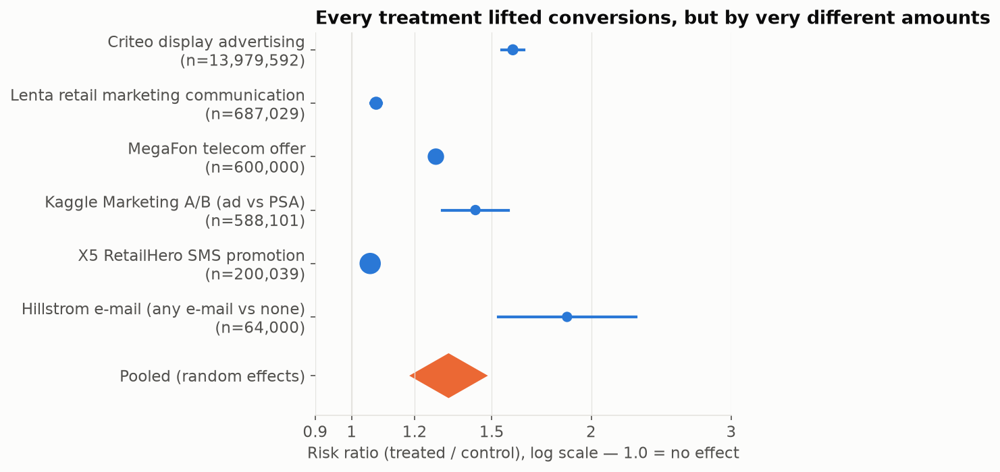
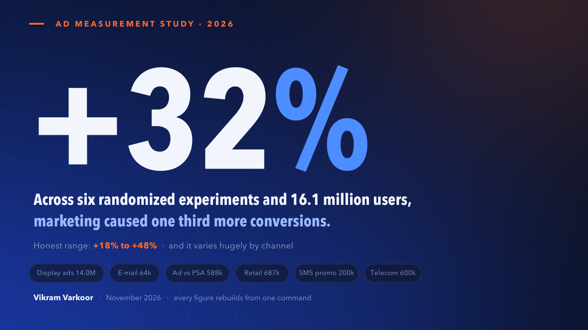

# Ad Measurement Study

**Public datasets, personal project.** A study of what marketing
actually causes, built the way a measurement team would build it:
randomized experiments first, honest uncertainty everywhere, and a
monitor for an e-commerce business on the side.

## The question, in plain English

Companies spend money showing people ads. Some of the people who then
buy **would have bought anyway**, so counting every buyer as an ad win
over-credits the ads. The only clean way to know what the ads *caused*
is an experiment: show ads to one random group, hold them back from
another, and compare. This project does exactly that, across six real
randomized experiments covering 16.1 million users, and then asks the
follow-up questions a business would ask: *who* should we target, *how
sure* are we, and *what should we watch weekly*?

## The answer

**Marketing caused about 32% more conversions across the six
experiments (pooled risk ratio 1.32, 95% CI 1.18 to 1.48).** A risk
ratio of 1.32 means the treated group converted 1.32 times as often as
the group that saw nothing. But the honest headline is the spread:
individual channels range from +6% to +87%, and the studies genuinely
disagree with each other (I² = 99.7%, a score where 0% would mean the
studies all agree). So a channel's own number only ever comes from a
channel's own experiment; the pooled figure is a summary, not a law.



## Live dashboards

📈 **[The experiments: lift by study, with intervals (Tableau Public)](https://public.tableau.com/app/profile/vikram.varkoor/viz/Marketing-Incrementality-Experiments/Dashboard1)** ·
📉 **[The e-commerce monitor: weekly orders, lateness, reviews (Looker Studio)](https://datastudio.google.com/reporting/91ee4f11-caab-4b8e-8fd7-fdde1dca2961)**

Both are built from the committed CSV feeds in `dashboards/`, so they
show exactly what the pipeline produces.

## The deck

14 slides written for a non-technical reader. GitHub cannot render a
.pptx inline, so the fastest read is the PDF, which opens right in the
browser:

[](deck/ad_measurement_deck.pdf)

📊 **[Read the deck in the browser (PDF)](deck/ad_measurement_deck.pdf)** ·
**[Download the deck (PPTX)](https://github.com/VikramVarkoor/Ad-Measurement-Study/releases/latest/download/ad_measurement_deck.pptx)** ·
📒 **[Download the measurement workbook (XLSX)](https://github.com/VikramVarkoor/Ad-Measurement-Study/releases/latest/download/measurement_tracker.xlsx)** ·
📋 **[The A/B-test playbook](docs/playbook.md)** · 📐 **[Methods](docs/methods.md)**

## Findings

("pp" below means percentage points: going from 1.0% to 1.5% is +0.5 pp.)

| # | Finding | Where |
|---|---|---|
| 1 | Every one of the six experiments shows a real lift. Each estimate comes with a 95% interval (the range of lifts consistent with the data), every interval excludes zero, and a second, independent method (the bootstrap) agrees everywhere | `results/lift_results.csv` |
| 2 | Criteo display ads: +0.12 pp on a 0.19% base, a 59% relative lift, measured on 13.98M users counted by the group they were assigned to | `results/lift_results.csv` |
| 3 | Pooled across studies: risk ratio 1.32 (1.18 to 1.48). Dropping any single study moves the pool between 1.26 and 1.40, so no one study owns the answer | `results/meta_results.csv` |
| 4 | The people ads actually move are a minority: messaging only the top 20% of Criteo users (ranked by a predictive model) keeps **68%** of the extra conversions. The same method on the small Hillstrom e-mail test barely beats random (25% vs 20%) and is reported as weak | `results/uplift_summary.csv` |
| 5 | CUPED, a standard trick for sharpening experiment results with past behaviour, narrowed the Hillstrom interval by only 0.02%: the past data barely predicted the outcome, so the trick had nothing to work with. Reported as the honest null it is | `results/cuped_hillstrom.csv` |
| 6 | The weekly monitor on the Olist marketplace flags 25 unusual weeks: the 2016-17 launch ramp and one Black Friday. Late-delivery share and review score never leave their normal bands | `results/monitor_flags.csv` |
| 7 | Orders more than 3 days late average **1.86 stars vs 4.29 on time**. Adjusting for product category, price, freight and seller state barely changes it. Association, not cause: nobody randomized lateness | `results/delay_adjusted_effect.csv` |
| 8 | Stretch: a weekly order forecast with rolling backtests, where the honest result is that the naive baseline beats LightGBM on 16 test weeks (MAE 228 vs 273): with ~80 weeks of usable history, a simple rule wins | `results/forecast_backtest.csv` |

## What this repository demonstrates

- **Metric definitions computed two ways.** Campaign KPIs (CTR, CPM,
  CPC, CPA, ROAS-under-assumption) in DuckDB SQL with window functions,
  matched exactly against pandas (`results/kpi_crosscheck.csv`) and
  rebuilt as live formulas in the Excel tracker, whose Checks sheet
  compares them to the Python pipeline.
- **Experiments read properly.** Intention to treat, sample-ratio
  checks, covariate balance, minimum detectable effect for every study,
  and inclusion rules committed to git before any analysis ran (see the
  history of `analysis_plan.md`).
- **Weak results reported weak.** The Hillstrom uplift model, the CUPED
  adjustment and the LightGBM forecast all underperform, and all three
  say so in every deliverable.
- **A served model.** The Criteo uplift model ships as a small FastAPI
  scoring service (`api/`), with the trained models committed so it
  runs from a fresh clone: `make api`, then POST to `/score`.
- **Machine-verified reporting.** The plain-English findings summary
  (`reports/findings_summary.md`) is generated from the results tables,
  and `src/verify_summary.py` re-checks every number in it against
  those tables; an edited or hallucinated number fails the build.

## Repository layout

```
analysis_plan.md       pre-registered questions, outcomes, inclusion rules
sql/                   kpis.sql, ecommerce.sql (DuckDB views, commented)
src/                   the pipeline: stats, meta-analysis, lift, uplift,
                       e-commerce, forecast, summary + verifier, Excel,
                       deck and background-art builders
api/                   FastAPI scoring service for the uplift model
models/                trained LightGBM boosters + score cutpoints
tests/                 known-answer tests (every expected value hand-computed)
results/               every table the pipeline produces (committed)
reports/               the generated, machine-verified findings summary
figures/               forest plot, uplift curves, monitor, delay, forecast
excel/                 measurement_tracker.xlsx
deck/                  ad_measurement_deck.pptx + .pdf + generated art
dashboards/            CSV feeds + build guide for Tableau Public / Looker Studio
docs/                  playbook.md, methods.md
data/raw/              downloads land here, never committed
```

## Reproduce everything

```bash
git clone https://github.com/VikramVarkoor/Ad-Measurement-Study.git
cd Ad-Measurement-Study
make venv      # python3 -m venv + pip install -r requirements.txt
make data      # ~800MB of public downloads (Criteo is 300MB)
make report    # rebuilds every table, figure, the workbook and the deck
make test      # 39 known-answer tests
```

Seeds are fixed; a fresh clone reproduces the numbers above. Built and
run on an 8GB MacBook: the 14M-row Criteo file is only ever touched
through DuckDB aggregates and a stratified 2M-row sample.

To run the scoring API locally:

```bash
pip install -r requirements-api.txt
uvicorn api.main:app --reload
```

## Limits: read before quoting

- Public data, personal project: no client, no employer, no business
  impact.
- The pooled 32% describes these six studies; it transfers to no
  platform.
- Part B is observational: late delivery is *associated* with worse
  reviews.
- Olist is a Brazilian marketplace (2016-18); it says nothing about any
  other shop. ROAS figures exist only under a stated $50/conversion
  assumption.
- The scoring API is a demo of serving a model, trained on public data;
  it makes no claim about any real audience.
- Tools: Python, DuckDB SQL, Excel, Tableau Public, Looker Studio. No
  SPSS, SAS or Power BI.

## Data credits and licences

| Dataset | Source | Licence / terms |
|---|---|---|
| Criteo Uplift v2.1 | [Criteo AI Lab via Hugging Face](https://huggingface.co/datasets/criteo/criteo-uplift) | CC BY-NC-SA 4.0 |
| Hillstrom e-mail | [MineThatData challenge](https://blog.minethatdata.com/2008/03/minethatdata-e-mail-analytics-and-data.html) | free for analysis, credited |
| Marketing A/B | [Kaggle: faviovaz/marketing-ab-testing](https://www.kaggle.com/datasets/faviovaz/marketing-ab-testing) | Kaggle terms, credited |
| Facebook ad campaigns | [Kaggle: loveall/clicks-conversion-tracking](https://www.kaggle.com/datasets/loveall/clicks-conversion-tracking) | Kaggle terms, credited |
| Olist e-commerce | [Kaggle: olistbr/brazilian-ecommerce](https://www.kaggle.com/datasets/olistbr/brazilian-ecommerce) | CC BY-NC-SA 4.0 (non-commercial) |
| Lenta / X5 / MegaFon | [scikit-uplift mirrors](https://www.uplift-modeling.com/en/latest/api/datasets/index.html) | public uplift datasets, credited |

Raw files are never committed or redistributed by this repository.
